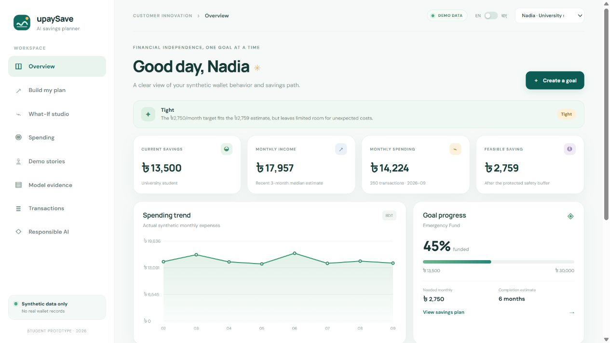

# upaySave AI

**AI-Powered Personal Savings Planner** · DIU CPC × upay AI Hackathon 2026

upaySave AI helps a mobile-wallet user check whether a savings goal fits their spending pattern. It forecasts synthetic demo profiles with a time-aware ML model; imported profiles use a personal rolling-three-month baseline until a governed real-data evaluation exists. It estimates a contribution after a protected safety buffer, explains the result in English or Bangla, and lets the user test spending scenarios.



This is a student prototype. Bundled demo people, transaction records, model results, and experiment results are synthetic. Optional user CSV imports are stored only in local SQLite and are not sent to external services. No production upay data or real customer identifiers are included. The app does not connect to upay production systems or make payments, lending decisions, or guaranteed outcome claims.

## What it demonstrates

- **Customer Innovation & Financial Independence:** behavior-aware goal planning with a user-controlled savings path.
- **Model:** Gradient Boosting, Extra Trees, and Random Forest are evaluated alongside last-month and rolling-three-month baselines with expanding-window validation. The selected model predicts next-month expenses.
- **Deterministic planning:** income estimate − predicted expenses − safety buffer = estimated feasible savings. Core financial calculations do not use an LLM.
- **Action:** the What-If studio recalculates the plan when Food, Shopping, Transport, or Entertainment assumptions change.
- **Transparency:** prediction, calculation, recommendation, and assumption are labeled separately. The planning status is not a credit score.
- **Privacy:** the seeded dataset is self-generated; imported transaction data stays in this device’s local SQLite database.

## How the project addresses review criteria

| Criterion | What the prototype demonstrates | Evidence boundary |
|---|---|---|
| Problem relevance | Turns a savings target into a cash-flow question: what may be left after expected expenses and a reserve? | The problem framing is a product hypothesis, not a measured customer need. |
| AI/ML depth | Chronological walk-forward comparison, two baselines, feature importance, synthetic occupation error slices, and an empirical model-error range. | Evaluation and error ranges use generated data only. The Random Forest is not applied to imported profiles. |
| Customer/business impact | A six-month scenario scorecard reports goal feasibility, positive-capacity share, projected savings, and synthetic occupation slices. | It is a fixed-assumption simulation, not an experiment, a causal result, or customer impact. |
| Prototype quality | Bilingual dashboard, keyboard-accessible monthly chart, goal contributions/history, mapped CSV preview, local save/export/delete, and visible estimate assumptions. | Local student prototype; not an account-backed consumer service. |
| Innovation | Volatility-adjusted safety reserve plus user-controlled What-If changes make the path adapt to cash-flow risk and personal choices. | Scenario choices are illustrations, not saving instructions. |
| Scalability & integration | Bounded/paginated API, indexed SQLite queries, OpenAPI docs, and a normalized CSV boundary provide a local integration foundation. | Production multi-user service, external wallet connector, and managed database are future work. |
| Responsible AI & security | User-imported data stays local; model origin is explicit; only synthetic profiles use the synthetic-trained estimator; host allowlist and security headers are enabled. | No authentication or application-level database encryption; do not expose this prototype to a network. |

## Architecture

```text
Synthetic CSVs + optional local CSV import ──> SQLite ──> FastAPI ──> responsive HTML/CSS/JS dashboard
       │                │         │
       └──> ML pipeline ┴──> joblib forecast model + JSON evaluation evidence
```

The API uses FastAPI and Pydantic, SQLite uses Python's built-in driver, and the modeling pipeline uses pandas, NumPy, scikit-learn, and joblib. The browser UI has no JavaScript package build step and draws charts on Canvas.

### Main folders

- `app/services/`: planning, spending analysis, recommendations, and explanation text
- `app/ml/`: temporal features, model comparison, evaluation, and inference
- `app/static/`: responsive dashboard, bilingual UI, original SVG mark
- `data/`: synthetic users, transactions, monthly features, personas, assumptions, experiment output
- `models/`: serialized estimator and saved metrics/feature importance
- `scripts/`: dataset generation, model training, database import, product simulation
- `tests/`: API and calculation tests
- `docs/`: judge demo and pitch story
- `sql/schema.sql`: readable schema reference; runtime schema is initialized in `app/db.py`

## Requirements and Windows setup

Python **3.12** is the target. The pinned versions have Windows wheels; no C/C++ build tool is required. From this folder in PowerShell:

```powershell
py -3.12 -m venv .venv
.venv\Scripts\Activate.ps1
python -m pip install --upgrade pip setuptools wheel
pip install -r requirements.txt
python scripts/generate_data.py
python scripts/train_model.py
python scripts/evaluate_product.py
python scripts/setup_db.py
python run.py
```

If PowerShell blocks activation, run this once in that terminal and activate again:

```powershell
Set-ExecutionPolicy -Scope Process -ExecutionPolicy Bypass
```

Then open:

- App: <http://localhost:8000>
- Interactive API docs: <http://localhost:8000/docs>
- Health check: <http://localhost:8000/api/health>

The first run generates a reproducible 250-user dataset, at least 10,000 transaction rows over 12 months, a trained model, JSON evidence, a product simulation, and `upaysave.sqlite3`. To regenerate all evidence, repeat the four scripts in order. The database is seeded only when its `users` table is empty. Delete `upaysave.sqlite3` before re-importing a regenerated dataset.

### Run individual tasks

```powershell
python scripts/generate_data.py
python scripts/train_model.py
python scripts/evaluate_product.py
python scripts/setup_db.py
python run.py
```

Optional local database path override: copy `.env.example` as a reference and set `UPAYSAVE_DB_PATH` in the shell before starting. The app reads the environment variable directly; it does not need a secrets file. No API keys are used.

## App walkthrough

1. The dashboard opens with Nadia; use the top-right selector to switch among Nadia, Arif, and Rafi.
2. **Overview** shows the selected persona's synthetic transactions, expense forecast, planning indicator, and goal progress.
3. **Build my plan** creates a goal and asks the backend to calculate a month-by-month contribution path.
4. **What-If studio** applies an assumption to category spending and requests a fresh calculation without reloading the page.
5. **Spending** shows the transaction-derived category mix, monthly trends, and explained unusual category patterns.
6. **Model evidence** reports walk-forward errors, baseline comparison, permutation importance, and the synthetic occupation-group error check.
7. **Transactions** previews optional CSV uploads, saves valid imports as separate local profiles, and filters rows by date, category, type, and amount. Imported profiles can be exported or deleted.
8. **Responsible AI** explains synthetic-data limits, user control, and the distinction between estimates and recommendations.

Switch **EN / বাং** in the header for the bilingual UI and Bengali explanations.

## API

Responses use `{ "data": ..., "error": null }` for successful endpoints. FastAPI validation and error responses include useful details.

| Endpoint | Purpose |
|---|---|
| `GET /api/health` | Runtime, database counts, model status |
| `GET /api/users` · `GET /api/users/{user_id}` | Demo and imported profiles |
| `GET /api/users/{user_id}/summary` | Dashboard overview and active goal estimate |
| `POST /api/import/columns` · `POST /api/import/preview` · `POST /api/import` | Map CSV columns, preview, validate, and save a separate profile locally |
| `GET /api/users/{user_id}/transactions/export` · `DELETE /api/import/{user_id}` | Export or remove an imported profile |
| `GET /api/users/{user_id}/transactions` | Filterable, paginated transaction rows (`date_from`, `date_to`, `category`, `amount_min`, `amount_max`, `transaction_type`, `limit` up to 500, `offset`) |
| `GET /api/users/{user_id}/spending` | Category totals, monthly trend, anomaly checks |
| `GET /api/users/{user_id}/forecast` | Next-month expense forecast and model label |
| `POST /api/goals` · `GET /api/goals/{goal_id}` | Create and inspect validated goals |
| `POST /api/goals/{goal_id}/plan` | Save and return an explainable savings plan |
| `POST /api/goals/{goal_id}/contributions` · `GET /api/goals/{goal_id}/history` | Record a goal contribution and view its progress history |
| `POST /api/goals/{goal_id}/what-if` | Recompute using category reduction assumptions |
| `GET /api/personas` · `GET /api/personas/{persona_id}` | Three judge demo personas |
| `GET /api/model/metrics` · `GET /api/model/features` | Saved validation metrics and feature importance |
| `GET /api/product-metrics` | Clearly labeled synthetic scenario simulation |
| `GET /api/responsible-ai` | Privacy, transparency, and governance notes |

CSV imports accept date/timestamp and amount columns, with optional category, transaction type, merchant, location, and channel. Debit and credit columns are also supported. Imports are capped at 8 MB and 50,000 rows, previewed before saving, and duplicate file content is rejected. The app binds to `127.0.0.1` by default, restricts accepted host names, and adds basic browser security headers. It has no account authentication, database encryption, or public multi-user support; do not expose it to a network.

Example what-if request:

```json
{"reductions":{"Shopping":0.15,"Food":0.05}}
```

Values represent fractions (15% and 5%); the API accepts 0–30% for Food, Shopping, Transport, and Entertainment. No money is moved.

## Data generation assumptions

`python scripts/generate_data.py` uses a fixed seed and writes `users.csv`, `transactions.csv`, `monthly_features.csv`, `personas.json`, and `synthetic_assumptions.json`. It simulates salary cycles, variable freelance income, food and bill patterns, category variation, seasonality, weekends, gradual changes, and a synthetic shopping spike for the Arif demo. Income is a monthly feature and is not represented as a transaction. The latest month is September 2026 in this generated project version. The three demo personas map to the first three synthetic IDs; the remaining 247 IDs are generic generated profiles.

## Model and evaluation

`monthly_features.csv` is ordered by user and month. Each row's target is that user's following month total expense; future rows are never randomly mixed into training. Five expanding-window one-month-ahead folds compare:

- Last-month expense
- Rolling-three-month mean
- Gradient Boosting
- Extra Trees
- Random Forest

The selected model minimizes mean validation MAE among the ML candidates. The pipeline reports MAE, RMSE, R² and MAPE for every candidate and baseline in `models/metrics.json`, then saves the trained estimator in `models/expense_model.joblib`. Permutation importance is calculated on the final two chronological target months and written to `models/feature_importance.json`. Synthetic occupation-group MAE is included where a group has enough held-out rows. The app derives a descriptive range from the selected model's 90th-percentile absolute walk-forward error; this is not a calibrated probability interval. Imported profiles use their own recent expense mean and observed month range instead of applying the synthetic-trained model. In the bundled run, Random Forest reached MAE ৳2,652.80, RMSE ৳3,524.22, R² 0.9519, and MAPE 7.28%. It improved on the last-month baseline by 16.67%, while the rolling-three-month baseline was 1.87% lower MAE than the model. Both comparisons are shown to keep the evidence honest. A run's metrics may vary if the generator, split, or estimator settings change.

The current saved model's empirical 90th-percentile absolute validation error is ৳5,744.04. The dashboard uses this as a global descriptive error band around synthetic-profile forecasts; it is not a per-person confidence interval or a guarantee.

`python scripts/evaluate_product.py` compares a six-month synthetic control scenario with an illustrative treatment scenario that reduces Shopping expenses by 8%. In the bundled 250-profile run, benchmark goal feasibility is 86.0% → 86.4% (+0.4 percentage points), while positive-capacity share is 90.0% → 92.4%. Average projected six-month savings per profile is ৳7,332.67 → ৳7,510.64. The UI also shows occupation slices. This is an arithmetic simulation, not a field experiment, causal finding, or real-customer impact claim.

## Tests

After installing requirements and generating data/model evidence:

```powershell
python -m pytest -q
```

The suite covers database/API health, seeded personas, summaries, expense forecasting, goal creation and validation, planning, what-if updates, transaction filtering, CSV preview and validation, duplicate-import protection, import export/deletion, already-funded goals, zero savings, low income, missing transaction history, empty categories, and variable income.

## Responsible AI and limitations

- Bundled demo data is synthetic. User-imported transaction data stays in local SQLite and is never sent to external services.
- The ML artifact is trained on synthetic data and is used only for synthetic demo profiles; imported profiles use a personal-history baseline.
- Estimates can be wrong and are not guarantees. A minimum safety buffer of ৳1,000 or 5% of estimated income, whichever is higher, is held before feasible savings is calculated. Recent income volatility can raise the reserve rate up to 20%.
- A missing transaction history does not count as zero spending: a conservative 75%-of-profile-income expense assumption is used and disclosed.
- Anomaly detection describes unusual personal spending patterns. It is not fraud detection or a judgment about a person.
- The planning indicator is not a credit score, lending decision, or suitability assessment.
- Recommendations are explainable, reversible ideas. The app does not make payments, autonomously move money, promote debt, or hide fees.
- Real-customer validation would require governed, anonymized or aggregated data and controlled experimentation.
- The server defaults to loopback and adds host validation and browser security headers, but it has no authentication or database encryption. Do not expose it to a network.

## Future roadmap

Add a governed data adapter behind the existing service interfaces, consent and retention controls, user-reviewed notifications, stronger seasonal uncertainty ranges, and a pre-registered controlled experiment. Keep production integration outside this synthetic demo until privacy, security, and model governance are approved.
